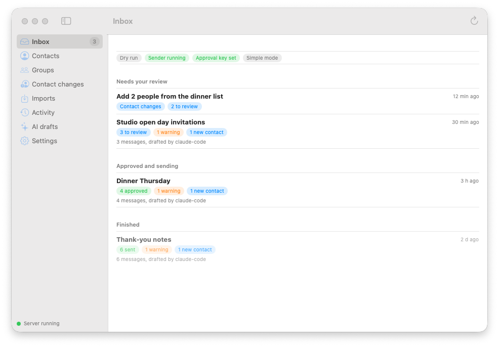

# Agent Outbox

[agent-outbox.halcyn.dev](https://agent-outbox.halcyn.dev)

Let AI agents draft your iMessages, but never send them. Claude Code, or any other MCP client, writes drafts and personalised batches (from a spreadsheet, a vCard file or your contacts) into the Agent Outbox Mac app. You read them, edit them and approve with Touch ID. Only then does a small separate program, the executor, send them through Messages.app. Everything runs locally: no server, account or cloud service.

The gate holds even when the agent is confused or prompt-injected: there is no send tool, no send API and no approve call for an agent to use, and the executor refuses anything not signed with the Touch ID key in your Mac's Secure Enclave.



## Get it

1. Download Agent Outbox from the [latest release](https://github.com/ay2609/agent-outbox/releases/latest) and move it to Applications.
2. Open it. The app is free and not notarized by Apple, so macOS blocks the first launch: in System Settings > Privacy & Security, click Open Anyway. Then follow the first-run steps: connect Claude Code (optional), allow Messages and Contacts, set up Touch ID.
3. Ask your agent to draft a text to yourself, then approve it in the app.

The app is the only way to use Agent Outbox: it holds the drafts, shows the approval sheet and runs the executor.

## Requirements

- Apple silicon Mac, macOS 14 or newer
- Touch ID, built in or on a Magic Keyboard with Touch ID. There is no password fallback: approving always needs your finger.
- Messages signed in to your Apple ID (for SMS to non-iPhones, turn on Text Message Forwarding on your iPhone)

## How it works

1. The agent calls `outbox_*` MCP tools (or the `agent-outbox` CLI). They can only create and edit drafts.
2. In the app you review each message, edit or skip any, and press Approve.
3. Touch ID signs a manifest listing every message's recipient and the SHA-256 of its exact text.
4. The executor checks the signature and that every message still matches, then hands it to Messages.app. A message edited after approval no longer matches and needs a new approval.

You start **live**: a message you approve with Touch ID is really sent. Nothing goes out without that approval, and every message needs its own. Contacts work the same way: new contacts, edits and undos your agent proposes wait for your Touch ID approval, and nothing is ever added to your Contacts automatically. On the first send macOS asks whether "Agent Outbox" may control Messages, and on the first contacts sync it asks for Contacts. Allow both only for "Agent Outbox".

The app's **AI draft** page has ready-made prompts to paste into your agent (text one person, personalise a batch, work from a spreadsheet, add contacts, check what was sent), each with a Copy button.

## Already using an earlier version?

Earlier builds also had a browser dashboard and passkeys. They are gone. After updating, the app asks you to set up Touch ID once more. Because this Mac was already set up, it first asks you to confirm it's you in Terminal:

```sh
"/Applications/Agent Outbox.app/Contents/MacOS/agent-outbox" recover
```

The app shows this exact line with a Copy button. It opens a 30-minute window in which the app can enrol a new Touch ID key; you still have to touch the sensor. If you didn't run it, press Cancel recovery in the app. Approvals made before the update were cancelled: approve them again in the app. The old passkeys can be deleted from your Passwords app.

## Simple and hardened mode

**Simple mode** (the default) keeps the list of trusted approval keys in a file you own. That stops an agent using its tools, and prompt injection, from sending anything. It does not stop a program running as you, outside a sandbox, from planting its own key in that file. Even then it can't approve anything: signing needs your finger.

**Hardened mode** moves the key list to a root-owned file, `/Library/Application Support/agent-outbox/passkeys.json`, and the executor then trusts only that. Settings > "Harden your install" shows the one sudo command. Run it yourself in Terminal; never let an agent run it. Do it before you rely on live sending, especially if an agent on this Mac has an unsandboxed shell.

## Dry run and live

To try things without sending anything, open Settings and switch **Sending** to **Dry run**: approved messages are only written to `~/Library/Application Support/agent-outbox/logs/dry-sends.jsonl` and Contacts is not touched. Switching back to **Live** asks for Touch ID.

Approved messages go out right away, 2 seconds apart (unless you turn on spreading, below). **Stop** halts everything and revokes unused approvals.

## Spreading out messages

If you send a lot at once, a burst can make a phone number or account look like spam. In Settings, **Spread out messages** (off by default) sends one message at a time with a random pause between them. Pick **Gentle** (30 to 90 seconds apart, up to 150 a day), **Careful** (2 to 5 minutes apart, up to 50 a day, nothing between 9 pm and 9 am), or **Custom** to set the pause, a daily limit (0 means none) and quiet hours yourself. Times use your Mac's clock. It also applies to dry runs, so a dry run shows the real schedule. Contact changes aren't spread out.

The approve sheet says how long a batch will take ("Sends over about 2 h 10 min"), and the batch page says when the next message goes. An approval normally lasts 24 hours; a long paced batch gets a longer window (its estimated length plus 12 hours, at most 7 days). If a batch would take more than 7 days, the sheet says how many messages fit and the rest would expire unsent. Only you can change this setting: agents can see it (the status call shows it, read-only) but not change it.

## MCP tools

All draft-only.

| Tool | Does |
|---|---|
| `outbox_search_contacts`, `outbox_get_contact` | Find people in your contacts |
| `outbox_create_draft` | One message |
| `outbox_create_batch`, `outbox_add_items`, `outbox_submit_batch` | A batch, optionally from a template with per-recipient fields |
| `outbox_update_draft`, `outbox_update_drafts`, `outbox_cancel_batch` | Edit or cancel before approval |
| `outbox_list_batches`, `outbox_get_batch` | Status, including what was sent |
| `outbox_ingest_file`, `outbox_get_import`, `outbox_set_mapping`, `outbox_batch_from_import` | Turn a CSV, XLSX, vCard or pasted table into a batch |
| `outbox_propose_contacts`, `outbox_contacts_from_import`, `outbox_get_contact_changes` | Propose new contacts or edits (both wait for your Touch ID approval; nothing is added automatically) |
| `outbox_list_groups`, `outbox_get_group`, `outbox_create_group`, `outbox_add_to_group`, `outbox_update_group`, `outbox_batch_from_group` | Saved groups of people (see below) |
| `outbox_sync_contacts` | Refresh the contact list |

Other MCP clients: run `"/Applications/Agent Outbox.app/Contents/MacOS/agent-outbox" mcp` as a stdio server. The same API is available as a CLI: `agent-outbox --help` (same binary).

## Groups

A group is a saved list of people ("Book club"), kept by Agent Outbox itself. They are not groups in the macOS Contacts app (those show up as contact tags). An agent can save one from a spreadsheet, a pasted list or your contacts, add to it later, and draft a personalised message to everyone in it; a group only chooses who a draft is addressed to, so every message still needs your Touch ID approval. Groups live under Contacts, then Groups in the app, where you can rename them, remove people, add people from your address book, and delete them (agents can't delete). A person stays in a group even if the contact is later removed from your address book.

## FAQ

**Why not give the agent AppleScript?** Then it can send anything, including text an attacker slipped into a file it read. Here the only program that can send checks a signature made with your finger.

**Why does macOS ask for permission again after an update?** The app and executor are ad-hoc signed, so each build is a new app to macOS. That's deliberate: a long-lived signing key on your Mac could sign a rogue app. If sends fail with error -1743, run `tccutil reset AppleEvents io.github.ay2609.agent-outbox.exec` and allow the prompt again.

**Can it read my replies or send group messages?** No and no.

**Uninstall?** Quit the app, move it to the Trash, and delete `~/Library/Application Support/agent-outbox` to remove your data.

## Acceptable use

Only send messages you'd send yourself, to people who expect to hear from you. No spam or unsolicited bulk texting. You're responsible for everything sent from your account, and bulk texting from a personal number can get your Apple ID flagged.

## Developers

Build the app from source (needs [Bun](https://bun.sh) 1.4 or newer and Xcode Command Line Tools with Swift 6):

```sh
bun install
scripts/build-app.sh          # dist/Agent Outbox.app, ad-hoc signed
```

Checks:

```sh
bunx tsc --noEmit -p . && bun test
cd exec && ./build.sh && build/OutboxExec.app/Contents/MacOS/outbox-exec selftest
cd app && swift build && .build/debug/AgentOutbox --selfcheck && swift run native-approval-selftest
```

`app/dev/README.md` explains how to run the app against a throwaway state directory.

Never weaken the send gate: no agent-facing tool may send, approve or change settings. Keep the Touch ID approval for every send.

MIT licensed. Security reports: see [SECURITY.md](SECURITY.md). Not affiliated with Apple; iMessage and Messages are Apple trademarks.
