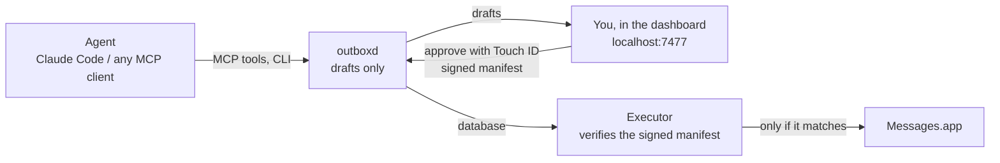
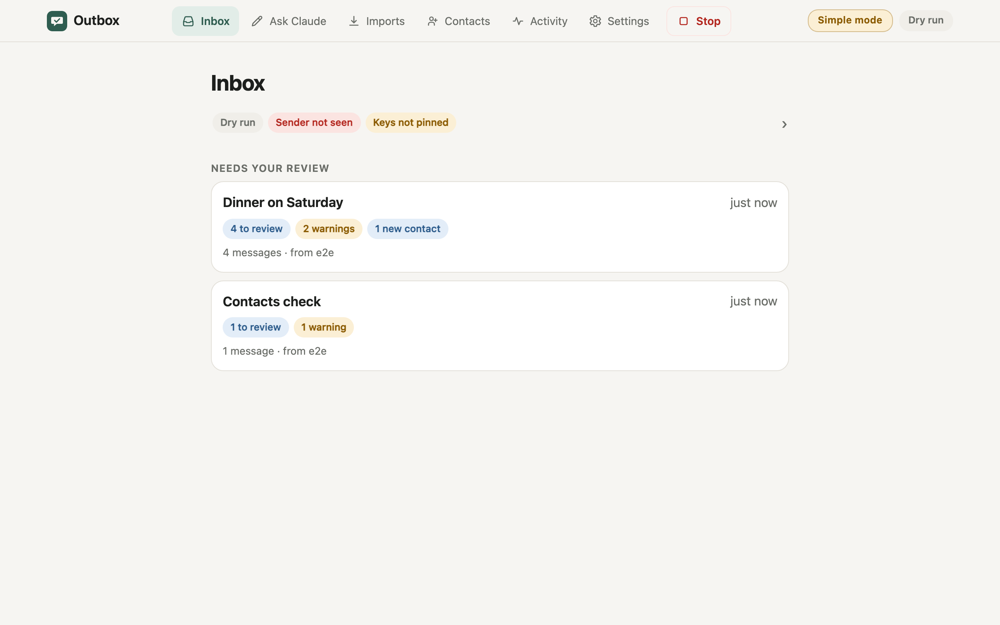
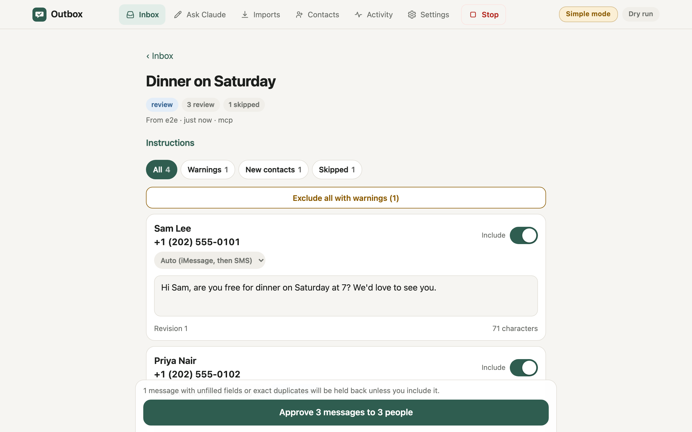
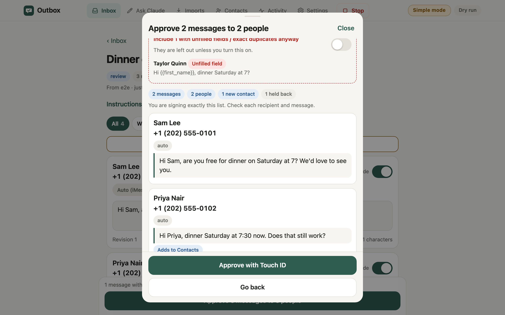
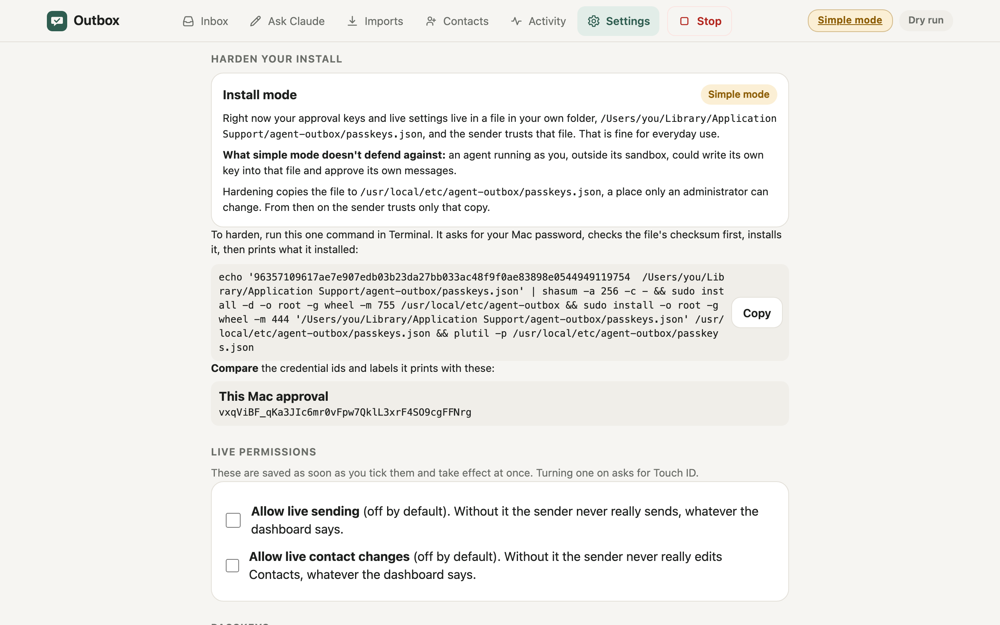
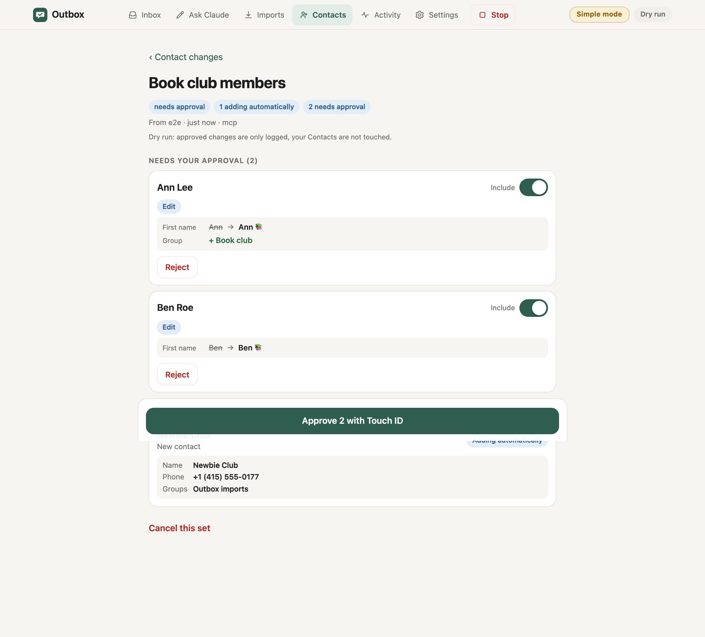

# Agent Outbox

Let AI agents draft your iMessages, but never send them. Claude Code, or any other MCP client, writes drafts and personalised batches (from a spreadsheet, a vCard file or your contacts) into a dashboard on your own Mac. You read them, edit them, and approve with Touch ID. Only then does a small separate program, the executor, send them through Messages.app. Everything runs locally; there is no server, account or cloud service.

The point is a gate that holds even when the agent is confused or has been prompt-injected: there is no send tool, no send API and no approve call for an agent to use, and the executor refuses anything that was not signed with your passkey.

## How it works



1. The agent calls `outbox_*` tools (or the `outbox` CLI). They can only create and edit drafts.
2. You open `http://localhost:7477`, review each message, edit or skip any, and press Approve.
3. Approving makes your Mac ask for Touch ID. The signature covers a manifest listing every message's recipient, service and SHA-256 of the exact text.
4. The executor, a separate Swift program, checks that signature against the keys it trusts, checks every message still matches the manifest, and only then hands it to Messages.app. Edit a message after approving and it no longer matches, so it needs a new approval.

Design details are in [docs/ARCHITECTURE.md](docs/ARCHITECTURE.md) and the threat model is in [SECURITY.md](SECURITY.md).

## Features

- Drafts and personalised batches. Merge fields such as `{{first_name|there}}`, plus optional per-recipient rewriting by the agent, with warnings for the things worth a second look (unfilled fields, duplicates, the same person messaged in the last 7 days, non-mobile numbers, very long text).
- Import people from CSV, TSV, XLSX/XLS/ODS/Numbers, vCard, JSON/JSONL or pasted tables. Columns are mapped for you (confirm if unsure), phone numbers normalised, duplicates removed, rows matched to your existing contacts.
- Contact changes. Agents can propose new contacts (added after a live duplicate check) and edits to existing ones (edits wait for your Touch ID). Every change can be undone.
- Touch ID approvals: a platform passkey signs exactly what you saw. Separate keys sign you in and approve sending.
- Dry mode by default. Until you switch to live, approved messages are only written to a log file.
- A Stop button that halts all sending and revokes unused approvals, no passkey needed.
- Optional "Ask Claude" box in the dashboard (uses the `claude` command if it is installed).
- Runs only on your Mac: the dashboard listens on `127.0.0.1`, the agent API is a unix socket.

## Requirements

- macOS 14 or newer, Apple silicon or Intel.
- [Bun](https://bun.sh) (`brew install oven-sh/bun/bun`).
- Xcode Command Line Tools (`xcode-select --install`). The executor is built on your machine with Swift; no full Xcode is needed.
- Messages signed in to your Apple ID. For SMS to non-iPhones, turn on Text Message Forwarding for this Mac on your iPhone.
- A browser with passkey support (Safari or Chrome). Touch ID is recommended; see the FAQ for Macs without it.

## Install

```sh
git clone https://github.com/ay2609/agent-outbox.git
cd agent-outbox
./install.sh
```

The installer checks your Mac, installs dependencies, builds the dashboard and the executor, creates the state directory, writes two per-user LaunchAgents, starts them, waits for the dashboard to answer, and registers the MCP server with Claude Code if `claude` is installed. It never uses sudo, and re-running it upgrades an existing install.

Options: `--port N` (default 7477), `--no-mcp`, `--dry-run` (print every step, change nothing), `--help`.

Where things live:

| What | Where |
|---|---|
| State (database, settings, passkey copy, logs, imports) | `~/Library/Application Support/agent-outbox` (override with `OUTBOX_HOME`) |
| LaunchAgents | `~/Library/LaunchAgents/io.github.ay2609.agent-outbox.plist` and `.exec.plist` |
| Executor app | `exec/build/OutboxExec.app` (shown to macOS as "Agent Outbox") |
| Logs | `<state>/logs/` |

## First run

1. Open `http://localhost:7477`. Use `localhost`, not `127.0.0.1`: passkeys are tied to that name.
2. Create the two passkeys it asks for with Touch ID: one to sign in, one to approve sending.
3. You start in dry mode and simple mode (explained below). Ask your agent to draft a text, then approve it in the dashboard. The message is written to `<state>/logs/dry-sends.jsonl` and nothing is sent.

## Simple mode and hardened mode

The executor only sends what is signed by a key it trusts, so the question is where it reads those trusted keys from.

**Simple mode (the default).** The keys live in a file in your state directory. This protects you from an agent that uses the tools it is given, including one that has been tricked by something it read in an imported file or on a web page: it has no way to send. It does not protect you from a program running as your user, outside a sandbox, that deliberately plants its own key in that file and forges approvals. Plain shell access as you is enough for that.

**Hardened mode.** The keys live in a root-owned file, `/usr/local/etc/agent-outbox/passkeys.json`, that nothing running as your user can change. The executor then ignores the user file entirely. Switching takes one command: Settings > "Harden your install" shows it. It checks the file's SHA-256 first and then runs two `sudo install` commands. You run it yourself in Terminal; the agent should never be allowed to. After that, changing your approval keys or the live-sending switch means running the command again; only do that right after you changed something yourself. Hardened mode still does not stop a program running as you from rewriting the dashboard to trick you into approving its messages; SECURITY.md lists what remains.

Use simple mode to try it out. Use hardened mode before you let it send anything you care about, particularly if an agent on this Mac can run shell commands without a sandbox. Details: [SECURITY.md](SECURITY.md).

## Going live

1. Settings: tick "Allow live sending" (this needs Touch ID to turn on in simple mode; in hardened mode it needs the sudo command re-run).
2. Settings: switch the transport to live. Each approval records which transport it was signed for, and the confirm sheet says "LIVE" when messages will really be sent.
3. The first live send makes macOS ask whether "Agent Outbox" may control Messages. The first contacts sync, or contact change, asks for Contacts access. Allow both for "Agent Outbox". If a prompt names Terminal, Bun or `osascript`, or a prompt appears that you did not just cause, click Don't Allow.
4. Send a first message to yourself.

Approved messages go out right away, one at a time with a 2 second gap. Nothing checks delivery; a message counts as sent once Messages.app accepts it.

## Uninstall

```sh
./uninstall.sh            # stop and remove the services and the MCP registration, keep your data
./uninstall.sh --purge    # also delete the state directory (asks first; --yes skips the question)
```

`--dry-run` shows what would happen. If you hardened your install, the script prints the one `sudo rm` command that removes the root-owned key file; it never runs sudo itself.

## MCP tools

The server is `agent-outbox`, registered with `claude mcp add --scope user agent-outbox -- <bun> run <repo>/src/mcp/index.ts`. For other MCP clients, run that command as a stdio server. All tools are draft-only.

| Tool | Does |
|---|---|
| `outbox_search_contacts`, `outbox_get_contact` | Find people in your contacts (read-only) |
| `outbox_create_draft` | One message, as a one-item batch in review |
| `outbox_create_batch` | A titled batch, optionally from a template with per-recipient variables |
| `outbox_add_items`, `outbox_submit_batch` | Add drafts to a batch, then hand it to you for review |
| `outbox_update_draft`, `outbox_update_drafts` | Edit text before approval |
| `outbox_cancel_batch` | Cancel the agent's own unapproved batch |
| `outbox_list_batches`, `outbox_get_batch` | Check status, including what was sent or failed |
| `outbox_ingest_file`, `outbox_get_import`, `outbox_set_mapping` | Read a spreadsheet, vCard or pasted table and map its columns |
| `outbox_batch_from_import` | Turn an import into a batch with a merge template |
| `outbox_propose_contacts`, `outbox_contacts_from_import` | Propose new contacts or edits |
| `outbox_get_contact_changes` | Check the state of proposed contact changes |
| `outbox_sync_contacts` | Ask the executor to refresh the contact list |

## CLI

The `outbox` command talks to the same draft-only API. From the repo:

```sh
bun run cli status
bun run cli contacts search "sam"
bun run cli draft --to +15551234567 --body "Running 10 minutes late"
bun run cli import people.csv
bun run cli batch show <batch_id>
bun run cli --help
```

## Configuration

Optional file `<state>/config.json`. Unknown keys are ignored; a file that is not valid JSON is ignored with a warning in the log.

```json
{ "port": 7477, "compose": "auto", "claude_path": "/abs/path/to/claude" }
```

| Key | Meaning |
|---|---|
| `port` | Dashboard port on `127.0.0.1` (default 7477). `./install.sh --port N` writes it. |
| `compose` | `"auto"` shows the "Ask Claude" box when a `claude` command is found, `"off"` hides it. |
| `claude_path` | Full path to `claude` if it is not on `PATH` or in `~/.local/bin`. |

Environment variables: `OUTBOX_HOME` (state directory) and `OUTBOX_PORT` (port; overrides `config.json`). After changing the port, re-run `./install.sh` so the services restart on it, and use the new address in your browser. Your passkeys keep working (they are tied to the name `localhost`, not the port); the server rewrites its pin file for the new address on start, and in hardened mode you run the harden command again.

## FAQ

**Why not just give the agent AppleScript for Messages?** Then the agent can send whatever it likes, including text an attacker slipped into a file it read, and you find out afterwards. Here the agent has no path to sending at all, and the one program that can send checks a signature you made with your finger.

**My Mac has no Touch ID.** A passkey can instead be unlocked with your Mac login password, or you can use a passkey on your phone (the browser shows a QR code). Everything else is the same.

**Does it work with MCP clients other than Claude Code?** Yes. The server is a plain stdio MCP server; point any client at `bun run src/mcp/index.ts`. The CLI and the unix socket in `<state>/run/agent.sock` work too.

**Why is the executor only ad-hoc signed, and why does macOS ask for permission again after I update?** macOS ties the Messages and Contacts permissions to the executor's code identity. An ad-hoc signature is bound to the exact build, so a rebuilt or replaced binary is a new app and gets no permission until you allow it. That is deliberate: a long-lived signing key on your Mac is something a rogue program could use to sign its own Messages-capable app. The cost is one more click after each upgrade. If sends fail with error -1743 after an upgrade, run `tccutil reset AppleEvents io.github.ay2609.agent-outbox.exec`, then `launchctl kickstart -k gui/$(id -u)/io.github.ay2609.agent-outbox.exec`, and allow the prompt.

**Can it read my replies?** No. It only sends, and it only reads your contact list.

**Does it send group messages?** No, one recipient per message.

## Acceptable use

Agent Outbox is for messages you would be willing to send yourself, to people who expect to hear from you. Do not use it for spam, unsolicited bulk texting, harassment or anything that breaks the law or Apple's terms. You are responsible for every message sent from your account. Sending many messages to many people from a personal number can get your Apple ID or number flagged or limited by Apple, and Apple publishes no sending limits. Start small.

## Screenshots

All screenshots use made-up data.

| Inbox | Reviewing a batch |
|---|---|
|  |  |
| **Approving with Touch ID** | **Harden your install** |
|  |  |

Contact changes proposed by an agent: 

## Contributing and security

See [CONTRIBUTING.md](CONTRIBUTING.md). Report vulnerabilities privately as described in [SECURITY.md](SECURITY.md). Licensed under the [MIT License](LICENSE).

Agent Outbox is an independent project and is not affiliated with, endorsed by or sponsored by Apple. iMessage and Messages are trademarks of Apple Inc.
